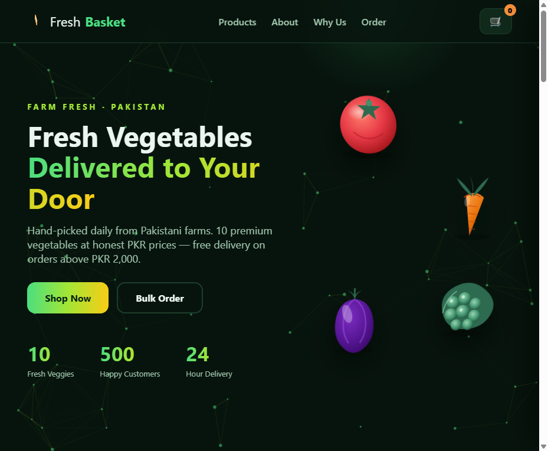
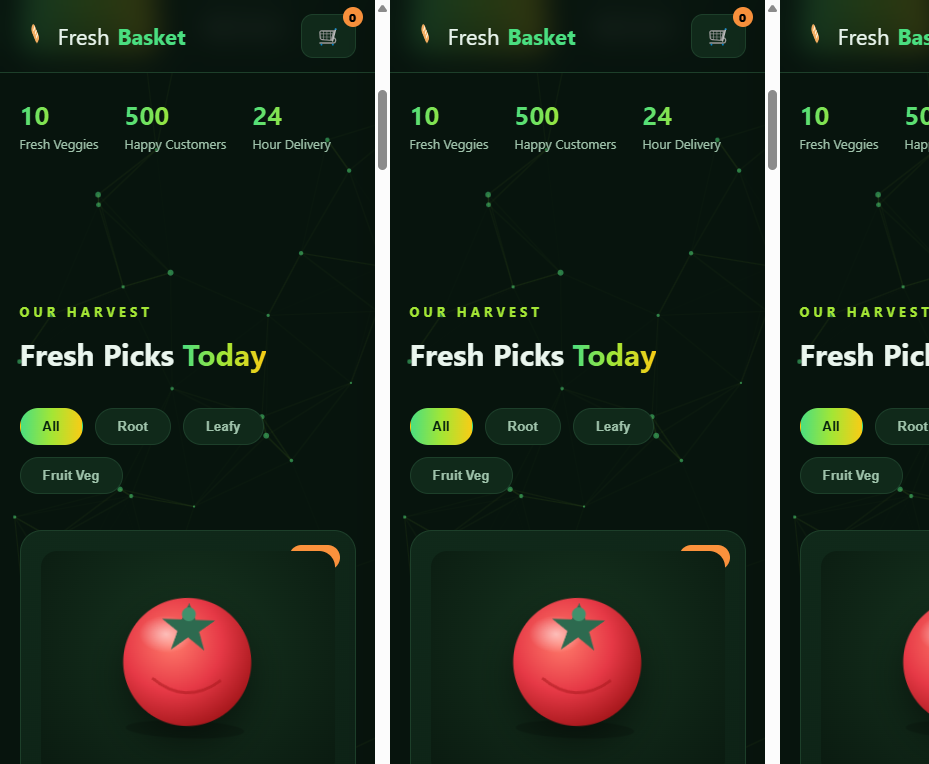
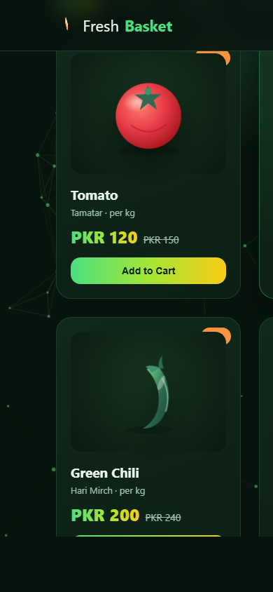

# Fresh Basket — 3D Vegetable Shop (Pakistan)

A complete animated 3D vegetable e-commerce website with a **Node.js backend** — 10 farm-fresh vegetables at PKR prices, cart, checkout, order persistence, and WhatsApp ordering.

Built by **ZN DEVELOPER** — CEO Zain Hanif.

## Features

- **3D animations** — CSS-3D floating hero vegetables with mouse parallax, 3D tilt product cards with cursor-tracked glow, 3D "why us" cards, rotating logo, particle network background, loader, animated counters, cursor glow.
- **10 products in PKR** — Tomato (120), Potato (80), Onion (140), Spinach (60), Carrot (110), Green Chili (200), Brinjal (130), Lady Finger (160), Cucumber (100), Peas (180) — each with an original SVG illustration, Urdu name, unit, sale badge.
- **Category filters** — All / Root / Leafy / Fruit Veg.
- **Cart** — slide-in panel, quantity controls, totals, localStorage persistence.
- **Checkout** — order form → `POST /api/orders` with server-side validation (PK phone regex, item re-pricing server-side). One-click **WhatsApp order** button (`wa.me/923214026676`) with prefilled cart text.
- **Backend (zero-dependency Node.js)** — static serving + REST API, orders persisted to `data/orders.json`.

## Run

```bash
node server.js            # → http://localhost:3600  (PORT env to change)
```

## API

| Method | Route | Description |
|---|---|---|
| GET | `/api/products` | 10 products (count, prices, categories) |
| GET | `/api/health` | service status + order count |
| POST | `/api/orders` | place order (name, PK phone, address, items) → `{ok,id,total}` |
| GET | `/api/orders?key=fresh2026` | list all persisted orders (admin key) |

Validation: name ≥ 2 chars, phone must match PK mobile (`03xxxxxxxxx`), address ≥ 6 chars, items re-priced server-side from the product catalog. Payload limit 64 KB.

## Verification (2026-10-16)

- `GET /api/health` → `{"ok":true,"service":"fresh-basket",...}` ✓
- `GET /api/products` → `count: 10` ✓
- Valid order → `201 {"ok":true,"id":1001,"total":350}` ✓
- Invalid phone → `400` ✓
- Admin orders list → returns persisted order ✓
- Browser E2E: 10 cards with PKR prices render, cart add → total PKR 410, checkout → **Order #1002 placed**, cart cleared, 0 console errors ✓

## Screenshots

| | |
|---|---|
|  |  |
|  | |

## Stack

Vanilla HTML/CSS/JS (frontend, no build step) · Node.js `http` module (backend, no npm deps) · SVG artwork · WhatsApp Business ordering.

© 2026 Fresh Basket · Built by ZN DEVELOPER
